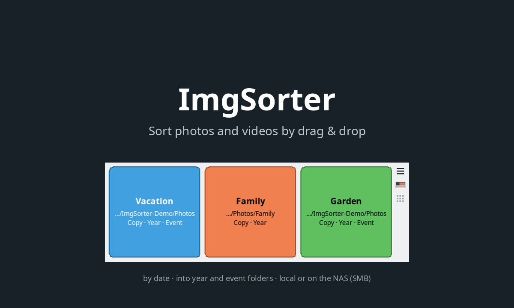

# ImgSorter
Sort photos and videos by drag &amp; drop into year/event folders. Reads dates from EXIF, video or filename, writes missing EXIF dates, fixes wrong camera clocks, detects duplicates, supports SMB and undo. Windows, Linux x64/ARM64.



*Demo in German: [docs/ImgSorter-Demo_de.gif](docs/ImgSorter-Demo_de.gif)*


| File | |
|---|---|
| `imgsorter_x64-linux_GTK2` | Linux 64 bit, GTK2 – **recommended** |
| `imgsorter_x64-linux_Qt5` | Linux 64 bit, Qt5 |
| `imgsorter_x64-win64.exe` | Windows 64 bit |
| `imgsorter_arm64-linux_GTK2` | Linux ARM 64 bit (Raspberry Pi), GTK2 – **recommended** |
| `imgsorter_arm64-linux_Qt5` | Linux ARM 64 bit (Raspberry Pi), Qt5 |

**ImgSorter** sorts photos and videos into folders by drag and drop: drop pictures onto a coloured tile – done. Optionally with year folders (from the capture date), event subfolders, network shares (SMB) and “Undo”.

### Which file?
Download just **one** file – it contains everything (translations, icon):
- **`imgsorter_x64-linux_GTK2`** – Linux, works on most systems (recommended)
- **`imgsorter_x64-linux_Qt5`** – Linux, looks a bit nicer on KDE, but needs Qt5
- **`imgsorter_x64-win64.exe`** – Windows
- **`imgsorter_arm64-linux_GTK2`** or **`_Qt5`** – Raspberry Pi 3/4/5 and other ARM computers with 64-bit Linux (e.g. Raspberry Pi OS 64-bit)

Runs on Linux on 64-bit PCs (x86_64) and 64-bit ARM (aarch64), and on Windows (64 bit). Not on a 32-bit Raspberry Pi OS – `uname -m` shows which one you have (`aarch64` works, `armv7l` does not).

### Requirements
- Linux, GTK2 version: GTK2, e.g. Debian/Ubuntu: `sudo apt install libgtk2.0-0`
- Linux, Qt5 version: Qt5 and the Pascal bindings, e.g. Debian/Ubuntu: `sudo apt install libqt5pas1`
- Linux, optional: `smbclient` (network shares without mounting), `imagemagick` (previews for HEIC/WebP), `curl` or `wget` (check for updates), `exiftool` (write capture dates into JPEGs with EXIF), `ffmpeg` (read video capture dates, convert videos without a date such as MTS/AVI/MKV losslessly to MP4/MOV)
- Windows: nothing else – `curl` for “Check for updates” comes with Windows 10/11

### Start
**Linux:**
```
chmod +x imgsorter_x64-linux_GTK2
./imgsorter_x64-linux_GTK2
```
or make it executable in your file manager and double-click it.

**Windows:** double-click `imgsorter_x64-win64.exe`. If “Windows protected your PC” appears, click **More info** → **Run anyway** (the program is not signed).

### First steps
1. Click **☰** at the top right → **Options**.
2. Under **Drop areas** create tiles: name, destination folder (local or `smb://server/share/path`, on Windows also `\\server\share\path`), **Move** or **Copy**, optionally year and event subfolders.
3. Drag photos, videos or whole folders onto a tile (on Windows e.g. from Explorer).
4. If a file already exists, ImgSorter asks: **Overwrite destination**, **Delete source**, **Do nothing** or **Save under new name**.
5. Afterwards the tile shows **Undo** for about 30 seconds.

### Good to know
- **Language:** click the flag below ☰.
- **Launcher in the application menu (Linux):** Options → **Add launcher to menu**.
- **Updates:** Options → **Check for updates** – downloads the new version and restarts.
- **Passwords** for network shares are never saved, only kept in memory until the program exits. Settings: Linux `~/.config/imgsorter/imgsorter.ini`, Windows `%LOCALAPPDATA%\imgsorter\imgsorter.ini`.
- **Windows, share with a different user:** Windows allows only one user per server at a time. If the server is already connected with another user (e.g. as a network drive), Windows reports error 1219 – enter the same user there or disconnect the other connection.

### Problems?
Linux: if nothing happens on double-click, a library is usually missing. Start it in a terminal – it will tell you what is missing (e.g. `libQt5Pas.so.1` → install `libqt5pas1` or use the GTK2 version).
